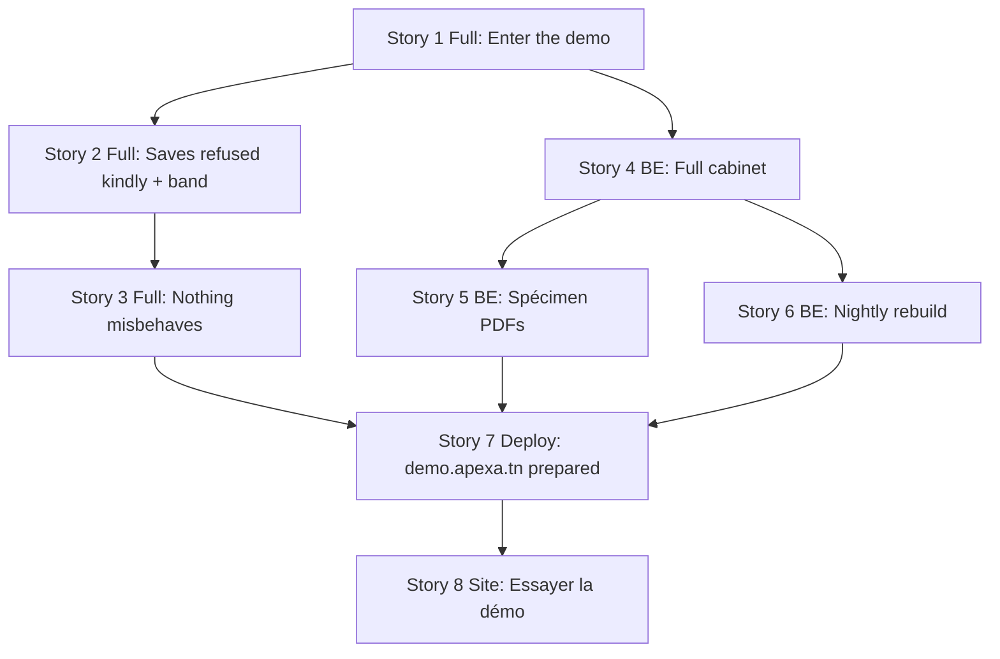

# Public demo cabinet - Implementation Stories

**Status:** APPROVED
**Plan:** [../plan.md](../plan.md) · **Spec:** [../spec.md](../spec.md) · **Facts:** [../exploration.md](../exploration.md)
**Branch:** `feature/demo-cabinet` (worktree `.claude/worktrees/demo-cabinet`)

## Summary

A fourth deployment kind, `PublicDemo`, serves a read-only « Cabinet Dentaire Démo » at `demo.apexa.tn` from the
production images, with its own database, keys and bucket. Visitors enter with one click, every save is refused
kindly, documents are marked « SPÉCIMEN », and the cabinet is rebuilt every night beside the old one.

⚠️ **Departure from the BE/FE single-layer default, deliberately.** The plan was sliced into vertical stories during
`/plan-feature` (each delivers something a visitor can see), so stories 1–3 are `Layer: Full`. Splitting them would
produce BE stories with nothing observable and FE stories that cannot run without them.

⚠️ **Stories 7 and 8 stop at the owner.** Nothing touches the VPS, DNS or the live website without her explicit OK
for that exact step (memories `never-touch-prod-without-consent`, `never-push-without-consent`,
`website-work-needs-two-pushes`).

## Story Dependencies

## Status Tracker

| Story | Layer | Name | Status | Depends On |
|-------|-------|------|--------|------------|
| 1 | Full | [A visitor enters the demo with one click](story-1-full-enter-the-demo.md) | done | - |
| 2 | Full | [A save is refused kindly; the band](story-2-full-saves-refused-kindly.md) | done | 1 |
| 3 | Full | [Nothing misbehaves around read-only](story-3-full-nothing-misbehaves.md) | done | 2 |
| 4 | BE | [The cabinet is full of believable work](story-4-be-full-cabinet.md) | reviewed | 1 |
| 5 | BE | [Documents print with « SPÉCIMEN »](story-5-be-specimen-documents.md) | reviewed | 4 |
| 6 | BE | [Rebuilt every night, nobody interrupted](story-6-be-nightly-rebuild.md) | reviewed | 4 |
| 7 | Deploy | [demo.apexa.tn prepared beside production](story-7-deploy-demo-host.md) | reviewed — owner applies | 3, 5, 6 |
| 8 | Site | [« Essayer la démo » on apexa.tn](story-8-site-try-the-demo.md) | not-started | 7 (live) |

## Shared rules for every story

- Work only in the worktree; `git status --short` + `git diff HEAD --numstat` before staging; never `git add -A`.
- Test on the **isolated stack** (`:5099` / `:3099`, own DB `clinic_demo_local`, `Deployment__Profile=PublicDemo`)
  — `stack-lease.ps1 status` first; never the shared `clinic_management` DB.
- API gate: full unfiltered `dotnet test -c Release` to a temp `BaseOutputPath`.
- Web gate: `npm run check:responsive` + `npx tsc --noEmit` + `npm run build`, then the eye pass.
- Docker cleanup at the end of any story that built images (global CLAUDE.md).
