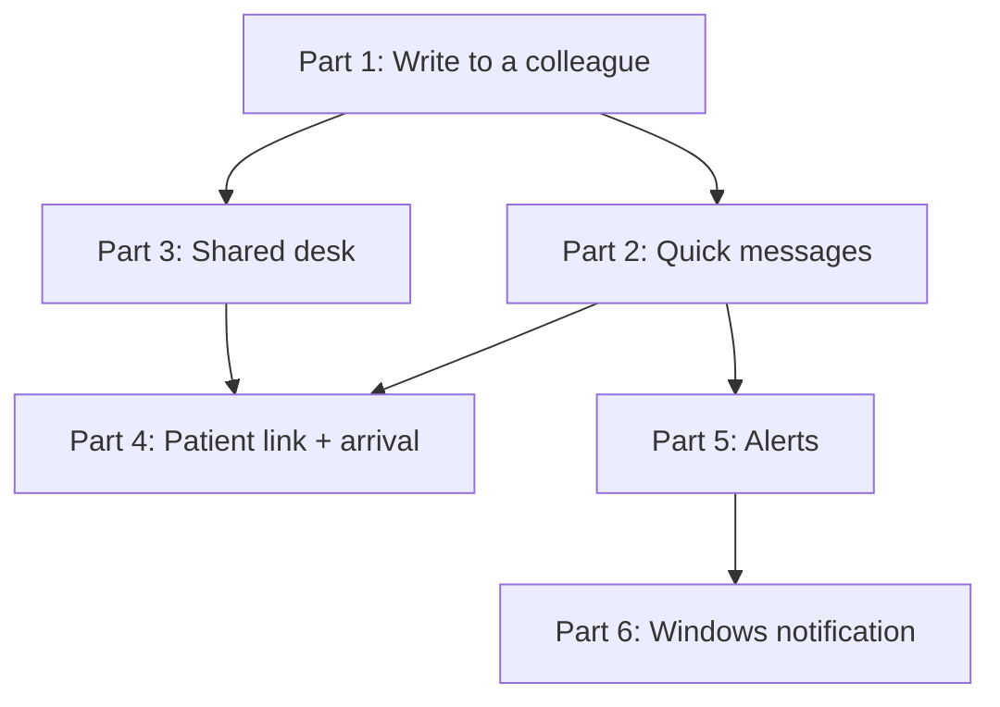

# Messagerie interne du cabinet - Implementation Stories

**Status:** APPROVED
**Plan:** [../plan.md](../plan.md)
**Spec:** [../spec.md](../spec.md)

## Summary

An internal chat between the accounts of one cabinet — dentists and secretariat — opened from every screen,
with one-click dental quick messages, « Secrétariat » threads for group practices, « Signaler l'arrivée » from the
agenda, and alerts that reach the person on another screen or in the minimised Windows app.

**One story, by the owner's choice (2026-10-15)** — a departure from the BE/FE-per-story default. It is `Layer:
Full` and built in **six ordered parts**, each a vertical increment (DB → server → API → UI) that compiles,
passes the gate and is **committed on its own**. The part boundary is the split point if a session runs out
(plan R-6).

## Story Dependencies

## Status Tracker

| Story | Layer | Name | Status | Depends On |
|-------|-------|------|--------|------------|
| 1 | Full | [Messagerie interne du cabinet](story-1-full-staff-chat.md) | implemented — not merged | - |

| Part | Name | Status |
|------|------|--------|
| 1 | Write to a colleague and read the answer | implemented |
| 2 | Quick messages in one click | implemented |
| 3 | Share the desk in a group practice | implemented |
| 4 | Patient link and arrival from the agenda | implemented |
| 5 | Be alerted wherever I am | implemented |
| 6 | Windows notification and flashing taskbar | implemented |
